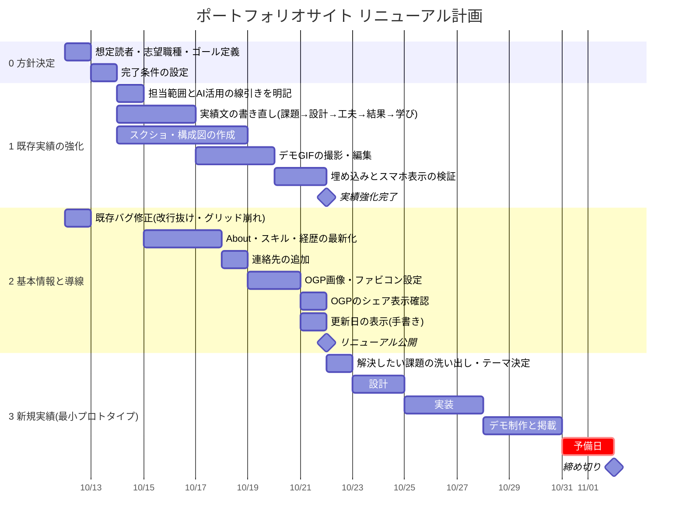

# リニューアル計画

締め切り：2026-11-02

## ゴールと完了条件

- **想定読者**：まだ職種を絞っていない私を見る人（講師・企業の人）
- **ゴール**：「人が学ぶこと・知ることを、改善する人」だと3分で伝わる
- **新規実績のテーマ**：英語学習の小さな補助ツール（最小プロトタイプ）

### 完了条件

- [ ] すべての実績に画像かGIFが1つ以上ある（Works 02 は開発中のため画像なし）
- [ ] すべての実績に「課題→工夫→結果→学び」が書かれている（Works 01・03 は済み、02 は未対応）
- [x] ボランティア経験（英語指導・環境保全祭りのガイド）が Activities に載っている
- [x] 連絡先がある（Googleフォーム）
- [x] スマホ幅で表示が崩れない（幅320〜1920pxの7サイズで確認）
- [x] 新規実績が最小限の形で公開されている（Elevator Talk、Works 03）

## あとでやるテスト・確認

本人が手元でやるもの。終わったらチェックを入れる。

- [ ] PageSpeed Insights（https://pagespeed.web.dev/）でトップと Elevator Talk を測る（Lighthouse では 2026-10-19 に全項目100を確認済み）
- [ ] 実機のスマホでトップと Elevator Talk の表示を確認する（iPhone と Android）
- [ ] 実機のスマホで Elevator Talk のマイク入力（文字起こし）を試す。特に iPhone の Safari
- [ ] お問い合わせフォームのボタンを押し、フォームが開いて回答を受け付けているか確認する
- [ ] LINE や Slack にURLを貼り、OGP画像が表示されるか確認する
- [ ] Elevator Talk のセリフの型（`works/elevator-talk/data.js` の THEMES）が自然な英語か確認する
- [ ] 違和感チェック8問（同じく CHECK_QUESTIONS）の英語と解説を確認する。特に「very delicious」「play with」の2問
- [ ] サークルのメンバーに Elevator Talk を使ってもらい、型ありと型なしで「話し切れた」割合を比べる
